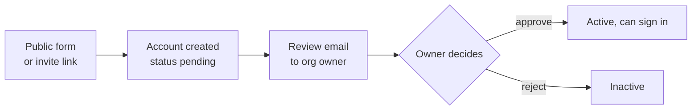
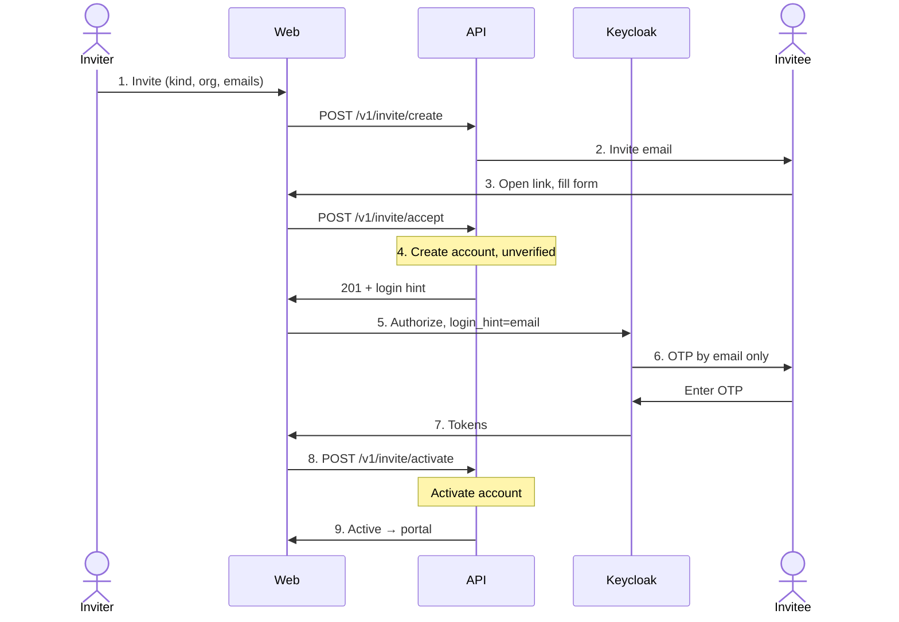
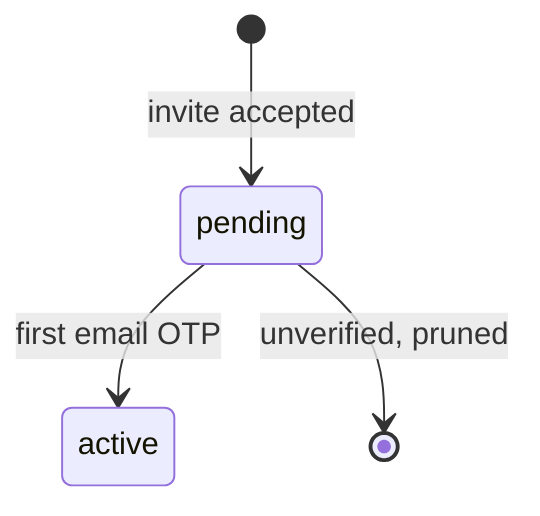
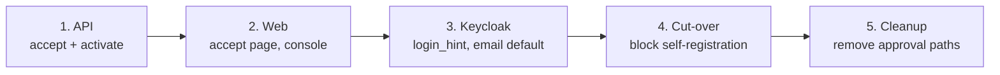

# Invite-only onboarding for orgs and coordinators

## Summary

Orgs and coordinators join only by invite. An invite sent by an org owner or admin needs no approval. The invitee submits the form, then verifies with an email OTP in place of approval, and lands in the portal signed in.

## Highlights

| Item              | Change                                                              |
| ----------------- | ------------------------------------------------------------------- |
| Self-registration | Removed for orgs (`/register/owner`) and coordinators (`/register`) |
| Approval hop      | Removed; the invitee is OTP-verified instead of approved            |
| APIs              | One invite API for both kinds: `create`, `read`, `accept`           |
| Email             | Locked to the invited address                                       |
| Sign-in           | Form submit → Keycloak OTP, email channel by default → portal       |

## 1. Scope

| In scope                                                                                   | Out of scope                                |
| ------------------------------------------------------------------------------------------ | ------------------------------------------- |
| Invite an org (child of an org the inviter holds `orgs.onboard` in)                        | Bulk participant onboarding                 |
| Invite a coordinator (into an org the inviter holds `org.manage` in)                       | Changes to roles and capabilities           |
| Activation on the first email OTP                                                          | Org tree limits (unchanged, still enforced) |
| Email OTP sign-in straight after accept; the OTP verifies the invitee in place of approval | Participant registration links              |
| Retiring the approval endpoints, emails and console actions                                | -                                           |

## 2. Flows

### Today

Org owners also get a grant link (`/register/invite?grant=`) after approval, which they use to invite coordinators without signing in.

### New

| Step | What happens                                                                                     |
| ---- | ------------------------------------------------------------------------------------------------ |
| 1    | Inviter picks the kind (`org` or `coordinator`) and the target org in the console                |
| 2    | One invite per recipient (existing mint logic, 14-day TTL from `INVITE_TOKEN_TTL_SECONDS`)       |
| 3    | One accept page renders the org or coordinator form by kind; the email is read-only              |
| 4    | Creates the account as `pending`; Keycloak user enabled with `decision_made = invited`, no roles |
| 5    | Web forwards `login_hint` so the identifier step is skipped                                      |
| 6    | An `invited` user gets the email channel only, so a passed OTP proves the invited email          |
| 7    | The portal gate admits `invited` users this far                                                  |
| 8    | The auth callback sees an unverified account and calls `activate` with the new token             |
| 9    | API runs the existing approve step; the session is refreshed so the new roles apply              |

`pending` now means "accepted, email not yet verified". Later sign-ins are normal and may use either channel.

## 3. One invite API for both kinds

`registration_invites` already has a `role` column and the invite token already carries a `role` claim. Both kinds share the mint, token, consume and release logic; only the form schema and the provisioning step differ.

| Endpoint                     | Auth                                                           | Purpose                                                                                        |
| ---------------------------- | -------------------------------------------------------------- | ---------------------------------------------------------------------------------------------- |
| `POST /v1/invite/create`     | `org.manage` (coordinator) or `orgs.onboard` (org) in `org_id` | Mint and email invites. Body `{ kind, org_id, recipients[] }`. Replaces `POST /v1/user/create` |
| `GET /v1/invite/read?token=` | Invite token                                                   | Kind, org name, locked email, expiry. Feeds the accept page                                    |
| `POST /v1/invite/accept`     | Invite token                                                   | Validate by kind, create the `pending` account, return `login_hint`                            |
| `POST /v1/invite/activate`   | User token (after email OTP)                                   | Activate the caller's own `pending` invited account; no-op when already active                 |

For an `org` invite, `org_id` is the parent; tree limits are checked at mint and again at accept.

| Kind          | `accept` (existing create logic, moved into a service) | `activate` (existing approve logic)                                                       |
| ------------- | ------------------------------------------------------ | ----------------------------------------------------------------------------------------- |
| `coordinator` | Body of `POST /v1/aggregator-registrations/create`     | `decideCoordinator(approve)`: Signals upsert, `decision_made = approved`, CAS to `active` |
| `org`         | Body of `POST /v1/orgs/create`                         | `decideOrg(approve)`: `grantOwnerAccess` (`org_owner`, group), CAS to `active`            |

The decider is recorded as `invite:<inviter id>`. A failed `activate` leaves the account `pending`; the next sign-in retries it.

### Retired

| Endpoint                                                                                                   | When                                        |
| ---------------------------------------------------------------------------------------------------------- | ------------------------------------------- |
| `POST /v1/orgs/create`, `POST /v1/aggregator-registrations/create`                                         | At cut-over                                 |
| `POST /v1/user/create`                                                                                     | At cut-over (moved to `/v1/invite/create`)  |
| `POST /admin/v1/invites` (owner grant)                                                                     | At cut-over; owners invite from the console |
| `/admin/v1/orgs/{read,decision,renew}/:id`, `/admin/v1/aggregator-registrations/{read,decision,renew}/:id` | After the pending backlog is drained        |
| `POST /v1/user/decision/:id`, `POST /v1/org/decision/:id`                                                  | After the pending backlog is drained        |

## 4. Changes by layer

### Database

| Item                                   | Change                                                   |
| -------------------------------------- | -------------------------------------------------------- |
| `registration_invites.role`            | Accept `org_owner` alongside `coordinator`               |
| `registration_invites_pending_unique`  | `(org_id, email)` → `(org_id, role, email)`              |
| `users.status`, `organisations.status` | No enum change; `pending` means awaiting first email OTP |
| Data migration                         | None                                                     |

### API

| Item                                | Change                                                                                     |
| ----------------------------------- | ------------------------------------------------------------------------------------------ |
| Invite routes                       | `routes/invites.ts` rewritten to hold the three endpoints above                            |
| Email lock                          | Reject when the submitted email differs from the invite (`INVITE_EMAIL_MISMATCH`)          |
| Review emails                       | Removed (`sendAdminReviewEmail`, `sendOrgReviewEmail`)                                     |
| Stale prune                         | `cleanup-stale` also deletes `pending` invited accounts not verified within the invite TTL |
| Approved emails and grant mail      | Removed; the invitee signs in directly                                                     |
| RBAC route table and `openapi.json` | Regenerated                                                                                |

### Web

| Item                                     | Change                                                                       |
| ---------------------------------------- | ---------------------------------------------------------------------------- |
| `/register`, `/register/owner`           | Removed; show "Onboarding is by invite only"                                 |
| `/register/coordinator?invite=`          | Becomes `/register/accept?invite=`, one page for both kinds                  |
| `/register/invite?grant=`                | Removed                                                                      |
| Console `invite` page                    | Add the kind choice; org list filtered by `orgs.onboard` or `org.manage`     |
| Console pending lists and decide buttons | Removed after the backlog is drained                                         |
| `/api/auth/login`                        | Forward `login_hint` to the authorize URL                                    |
| Accept submit                            | Redirect to `/api/auth/login?login_hint=<email>`                             |
| `/api/auth/callback`                     | Call `/v1/invite/activate` for an unverified account, then refresh the token |

### Keycloak

| Item                      | Change                                                                                                  | Where                                                       |
| ------------------------- | ------------------------------------------------------------------------------------------------------- | ----------------------------------------------------------- |
| `otp-identifier-form`     | Use `login_hint` and skip the identifier step                                                           | OTP SPI repo                                                |
| `otp-channel-choice-form` | New `otpChoice.defaultChannel=email`; skip the choice screen. Email only when `decision_made = invited` | OTP SPI repo + realm config                                 |
| Portal gate               | Admit `decision_made = invited` as well as `approved`                                                   | `apply-portal-gate.py` + its verifier test                  |
| `decision_made`           | New value `invited`; stays admin-only                                                                   | `apply-user-profile.sh` (no change if values are free text) |
| Deployment realm          | Same config                                                                                             | bluedots-automation                                         |

## 5. Rollout

| Phase        | Note                                                                                |
| ------------ | ----------------------------------------------------------------------------------- |
| 1–3          | Old paths keep working; ships as the API / Web / Infra PR stack                     |
| 4            | Self-registration endpoints return `404`; public forms removed                      |
| 5            | Pending rows are decided with the existing endpoints first, then those endpoints go |
| Open invites | Pending coordinator invites stay valid and are accepted on the new page             |

## 6. Risks and open questions

| Item                      | Detail                                                       | Proposal                             |
| ------------------------- | ------------------------------------------------------------ | ------------------------------------ |
| Notify the inviter        | Review email goes away; the inviter learns nothing on accept | Send a short "X has joined" email    |
| Grant links in old emails | Stop working at cut-over                                     | Show a sign-in prompt on the old URL |
| Default org               | Takes no invites, so no new members join it                  | Confirm this is intended             |
