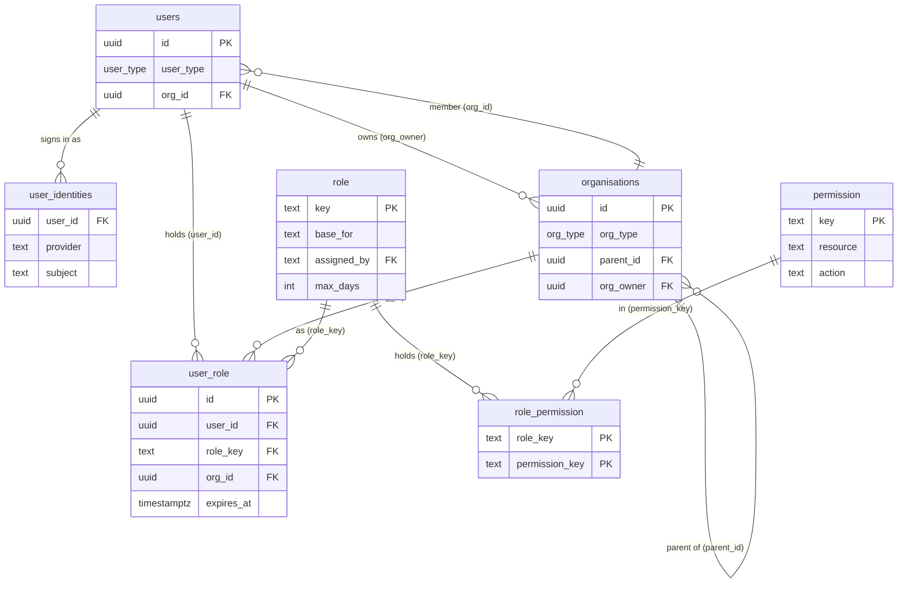
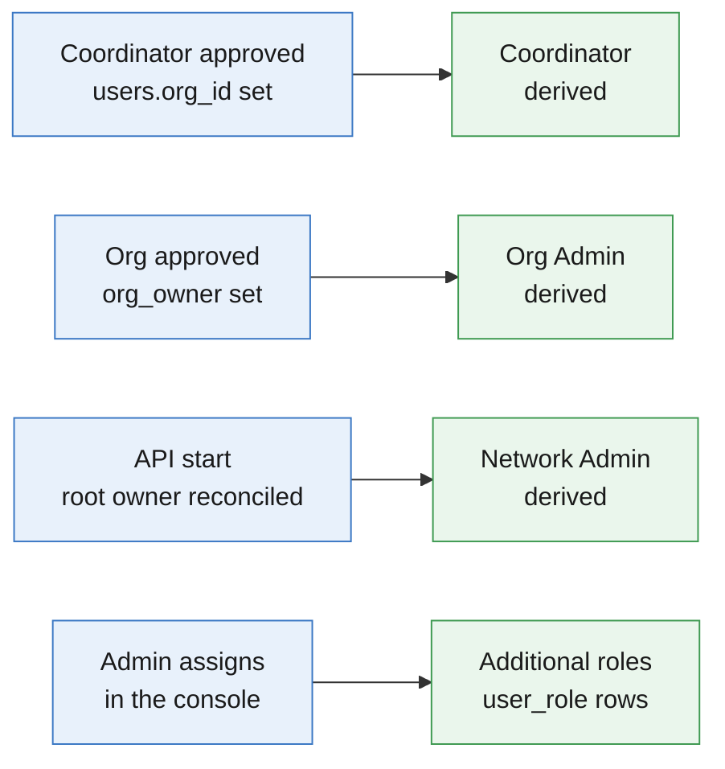
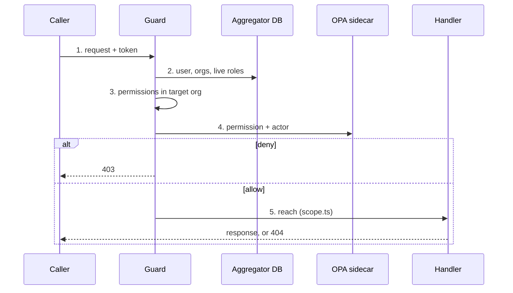
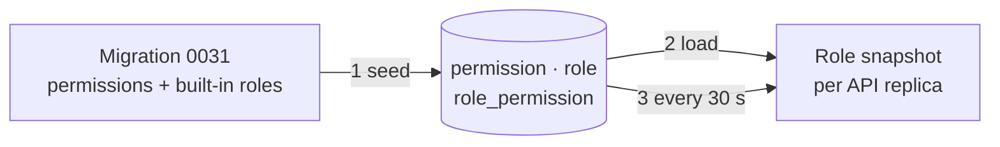
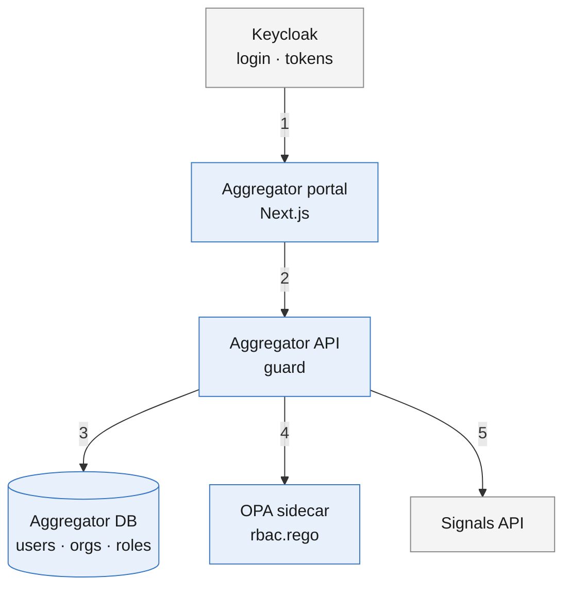

# RBAC Design v1 — aggregator-dpg

## Summary

Access control for the aggregator portal and API, on the user and organisation model of the user-org refactor (`users`, `organisations`). Permissions are grouped into roles, users hold roles in organisations, and an OPA sidecar decides every request. The permissions and roles are in [rbac-permissions-and-roles.md](rbac-permissions-and-roles.md).

## Highlights

| Item              | Decision                                                                                                                                                                                   |
| ----------------- | ------------------------------------------------------------------------------------------------------------------------------------------------------------------------------------------ |
| Model             | NIST core RBAC per organisation, on the user-org model: base roles come from membership (`users.org_id`, `organisations.org_owner`); `user_role` holds additional roles (decisions D5, D7) |
| Access            | Union of the permissions of the user's base and additional roles in the organisation acted on or its ancestors                                                                             |
| Built-in roles    | Defined in code (`BUILTIN_ROLES` in `packages/rbac`), seeded into the database by migration `0031_rbac_seed.sql` and changed with a new migration; custom roles live only in the database (decision D6) |
| Decide            | Per request: the actor resolver reads the user, their memberships and their additional roles; OPA decides the permission (403); `scope.ts` decides reach (404)                             |
| Time-bound access | PII Access is a role assigned with an expiry (90 days at most)                                                                                                                             |
| Scope             | aggregator-dpg; signals-dpg unchanged in v1                                                                                                                                                |

---

## 1. Data model

RBAC adds four tables to the user-org model and changes none of its tables.

### User-org tables RBAC reads

| Table             | Columns RBAC uses                                                                                                                                                              | Meaning                                              |
| ----------------- | ------------------------------------------------------------------------------------------------------------------------------------------------------------------------------ | ---------------------------------------------------- |
| `users`           | `id` (PK), `user_type` (`admin` / `coordinator`), `org_id` (FK → `organisations.id`; set for coordinators, NULL for admins)                                                    | One account per person per account type              |
| `organisations`   | `id` (PK), `org_type` (`network_facilitator` / `aggregator`), `parent_id` (FK → `organisations.id`; NULL only for the root), `org_owner` (FK → `users.id`, an admin), `status` | One owner per organisation; an admin may own several |
| `user_identities` | `user_id` (FK → `users.id`), `provider`, `subject`                                                                                                                             | Maps a Keycloak login to the account                 |

### RBAC tables

| Table             | Column                                   | Type                                              | Key / reference                                                              | On delete |
| ----------------- | ---------------------------------------- | ------------------------------------------------- | ---------------------------------------------------------------------------- | --------- |
| `permission`      | `key`                                    | text                                              | PK (`profiles.export`)                                                       | -         |
|                   | `resource`, `action`, `description`      | text                                              | -                                                                            | -         |
|                   | `sensitive`, `deprecated`                | boolean                                           | -                                                                            | -         |
| `role`            | `key`                                    | text                                              | PK                                                                           | -         |
|                   | `name`, `description`                    | text                                              | -                                                                            | -         |
|                   | `is_builtin`                             | boolean                                           | -                                                                            | -         |
|                   | `account_type`                           | `user_type`                                       | must match `users.user_type` of the holder                                   | -         |
|                   | `base_for`                               | text, nullable                                    | `org_member` / `org_owner` / `root_owner`; unique; NULL for additional roles | -         |
|                   | `assignable_org_types`                   | `org_type[]`                                      | -                                                                            | -         |
|                   | `assigned_by`                            | text, nullable                                    | FK → `permission.key` (NULL for base roles)                                  | RESTRICT  |
|                   | `max_days`                               | integer, nullable                                 | -                                                                            | -         |
| `role_permission` | `role_key`                               | text                                              | PK, FK → `role.key`                                                          | CASCADE   |
|                   | `permission_key`                         | text                                              | PK, FK → `permission.key`                                                    | RESTRICT  |
| `user_role`       | `id`                                     | uuid                                              | PK                                                                           | -         |
|                   | `user_id`                                | uuid                                              | FK → `users.id`                                                              | CASCADE   |
|                   | `role_key`                               | text                                              | FK → `role.key`; never a base role                                           | RESTRICT  |
|                   | `org_id`                                 | uuid                                              | FK → `organisations.id`                                                      | CASCADE   |
|                   | `granted_by`, `revoked_by`               | uuid, nullable                                    | FK → `users.id`                                                              | SET NULL  |
|                   | `granted_at`, `expires_at`, `revoked_at` | timestamptz (`expires_at`, `revoked_at` nullable) | -                                                                            | -         |
|                   |                                          |                                                   | UNIQUE (`user_id`, `role_key`, `org_id`) WHERE `revoked_at` IS NULL          | -         |
| `iam_audit`       | append-only                              | -                                                 | every assignment, revocation and custom-role change                          | -         |

### Base roles come from membership

| User-org relation                                                      | Base role (`role.base_for`)  | In organisation            |
| ---------------------------------------------------------------------- | ---------------------------- | -------------------------- |
| `users.org_id` = X, `user_type = coordinator`                          | Coordinator (`org_member`)   | X                          |
| `organisations.org_owner` = the user, `org_type = aggregator`          | Org Admin (`org_owner`)      | each organisation they own |
| `organisations.org_owner` = the user, `org_type = network_facilitator` | Network Admin (`root_owner`) | the root                   |

A base role is never stored: approving a coordinator, changing an owner or moving a coordinator changes the user-org row, and the base role follows on the next request. `user_role` holds only additional roles, and only in an organisation the user belongs to (`users.org_id`) or owns (`org_owner`).

When the planned membership table `user_orgs (user_id, org_id, role, status)` replaces `users.org_id`, its `role` column becomes a foreign key to `role.key`; the rest of RBAC is unchanged.

---

## 2. Who gets which role, when

Blue: user-org events. Green: the roles that result.

| Event                                    | Effect                                                                                                                                                                                                                 | Where it happens                                         |
| ---------------------------------------- | ---------------------------------------------------------------------------------------------------------------------------------------------------------------------------------------------------------------------- | -------------------------------------------------------- |
| Coordinator approved, or invite accepted | Coordinator in their organisation (derived from `users.org_id` and `status = active`)                                                                                                                                  | Coordinator decision service                             |
| Organisation approved                    | Org Admin for its owner (derived from `org_owner` and the organisation's `status = active`)                                                                                                                            | Org decision service                                     |
| API start                                | Network Admin for the root's owner (first `ADMIN_EMAILS`)                                                                                                                                                              | `services/organisation-root.ts` reconcile                |
| Console                                  | An additional role (`user_role` row), under the rules in the catalogue §4                                                                                                                                              | Roles API (§4)                                           |
| Expiry                                   | The additional role stops counting; the row stays                                                                                                                                                                      | Read per request, no job                                 |
| Owner replaced, coordinator rejected     | The base role goes with the user-org change. The user's additional roles in that organisation are revoked right after it; until then they count for nothing, because a role counts only where the user belongs or owns | The coordinator decision service; `organisation-root.ts` |

---

## 3. Checking a request

| Step | What happens                                                                                                                                                                                                                                                                                                                                                         |
| ---- | -------------------------------------------------------------------------------------------------------------------------------------------------------------------------------------------------------------------------------------------------------------------------------------------------------------------------------------------------------------------- |
| 1    | Keycloak token verified (issuer, signature, `azp` allow-list)                                                                                                                                                                                                                                                                                                        |
| 2    | The actor resolver (Phase 5) loads the user from `user_identities`, their memberships (`users.org_id`, owned organisations) and their unexpired, unrevoked `user_role` rows                                                                                                                                                                                          |
| 3    | The guard takes the base roles from the memberships and the additional roles from `user_role`, and expands them to permissions from the role snapshot (§5): the union over the target organisation and its ancestors. A route with no single target uses every organisation the user belongs to or owns; its handler checks the target organisation once it knows it |
| 4    | OPA allows when the user is active and holds the route's permission; it also refuses `profiles.view_pii` through the root organisation                                                                                                                                                                                                                               |
| 5    | `scope.ts` checks and filters reach; out of reach is 404                                                                                                                                                                                                                                                                                                             |

| Behaviour                           | Detail                                                                                                                                                                                                                                                                                                                                                                                                                           |
| ----------------------------------- | -------------------------------------------------------------------------------------------------------------------------------------------------------------------------------------------------------------------------------------------------------------------------------------------------------------------------------------------------------------------------------------------------------------------------------- |
| Every route declares its permission | `config.rbac` on the route; a route without one stops the boot; a snapshot test lists them                                                                                                                                                                                                                                                                                                                                       |
| Lists                               | The handler keeps only organisations where the user holds the permission (`scope.ts` filter)                                                                                                                                                                                                                                                                                                                                     |
| Portal UI                           | `GET /v1/user/read/me` returns the user's permissions per organisation; menus follow them                                                                                                                                                                                                                                                                                                                                        |
| OPA down                            | Deny (`503` in enforce mode)                                                                                                                                                                                                                                                                                                                                                                                                     |
| Mode                                | `RBAC_MODE`: `off`, `log` (decide and log, never block), `enforce`. Role and custom-role writes are checked strictly: refused in `log` too, since they have no pre-RBAC behaviour to preserve                                                                                                                                                                                                                                    |
| CUSTOM-ROLES toggle                 | `RBAC_CUSTOM_ROLES_ENABLED` (default `false`, opt-in): when off the role snapshot is built-in-only (so any existing custom-role assignment is inert via `effectivePermissions`), the three authoring routes are not registered (404, absent from OpenAPI), and `GET /v1/aggregator-config` reports `features.custom_roles: false`. Subordinate to `RBAC_MODE`: with `RBAC_MODE=off` nothing is loaded and the flag has no effect |

### Route declarations

Each route sets `config.rbac` in one of two forms (`services/authz/route-access.ts`):

| Form                                    | Caller must                                     | Notes                                                                           |
| --------------------------------------- | ----------------------------------------------- | ------------------------------------------------------------------------------- |
| `{ capability, strict? }`               | Hold the permission                             | `strict: true` refuses a deny in `log` mode too; used by the custom-role routes |
| `{ access: 'self' \| 'signed_in' \| …}` | Meet the access kind below; no permission check | For routes that are not about a permission                                      |

| `access`     | Meaning                                       | Checked by RBAC                                                                                                   |
| ------------ | --------------------------------------------- | ----------------------------------------------------------------------------------------------------------------- |
| `self`       | An active account acting on its own record    | The caller resolves to a known account, and it is active; else `unknown_actor`, `actor_unavailable` or `inactive` |
| `signed_in`  | Any known account                             | The caller resolves to a known account; active or not does not matter                                             |
| `service`    | A Keycloak service-account token, no end user | `preferred_username` starts with `service-account-`; else `not_service_account`                                   |
| `link_token` | A signed approval, grant or invite link       | Nothing: the route verifies the token itself                                                                      |
| `public`     | Anyone; rate limits apply                     | Nothing                                                                                                           |

With RBAC off nothing is checked; a failed check is logged in `log` mode and answered `403 FORBIDDEN` in `enforce` mode. `strict` applies to the `capability` form only: the role assign and revoke routes are `signed_in`, and their strict check runs inside the handler (`services/authz/roles.ts`).

| Log `operation` | Written when                                                     | Carries                                                                                                             |
| --------------- | ---------------------------------------------------------------- | ------------------------------------------------------------------------------------------------------------------- |
| `rbac.access`   | A `self`, `signed_in` or `service` check fails                   | The `access` value, route, method, user id, mode, reason; `status` is `skipped` in `log` and `failure` in `enforce` |
| `rbac.decide`   | A permission is decided (`capability` routes and handler checks) | The permission, route, method, user id, mode, allow, reasons, latency; an allow at `debug`, a deny at `warn`        |

---

## 4. Managing roles

| Endpoint                                                                             | Permission               | Does                                                                                                                  |
| ------------------------------------------------------------------------------------ | ------------------------ | --------------------------------------------------------------------------------------------------------------------- |
| `GET /v1/roles`                                                                      | `org.manage`             | Every role with its permissions, and the permission catalogue a custom role is composed from                          |
| `POST /v1/roles/create`, `PATCH /v1/roles/update/:key`, `POST /v1/roles/delete/:key` | `network.administer`     | Custom roles; built-in roles are refused                                                                              |
| `GET /v1/user/roles/:id`                                                             | `org.manage`             | A user's roles: base roles (derived) and additional roles, live and past                                              |
| `POST /v1/user/role/assign/:id`                                                      | The role's `assigned_by` | Assign an additional role in an organisation the user belongs to or owns, with an expiry when the role has `max_days` |
| `POST /v1/user/role/revoke/:id`                                                      | The role's `assigned_by` | Revoke an assignment                                                                                                  |

Every assignment checks, in order: the target is in reach (else 404), the role is not a base role, the target belongs to or owns the organisation, the caller holds the role's `assigned_by` permission there, the target is not the caller, the account type matches, the organisation type is assignable, and the expiry is within `max_days`. Each write and its `iam_audit` row commit together.

| Console page      | Who                      | Shows                                                                                        |
| ----------------- | ------------------------ | -------------------------------------------------------------------------------------------- |
| Coordinator page  | Org Admin, Network Admin | The coordinator's roles: assign and revoke PII Access, Data Export, custom coordinator roles |
| Organisation page | Network Admin            | The owner's roles: Org Onboarder, custom admin roles                                         |
| Roles             | Network Admin            | Built-in roles (read-only) and custom roles (create, edit, delete)                           |

---

## 5. Loading and refresh

| Step | What happens                                                                                                                                                                                                                                    |
| ---- | ----------------------------------------------------------------------------------------------------------------------------------------------------------------------------------------------------------------------------------------------- |
| 1    | Migration `0031_rbac_seed.sql` seeds the permission catalogue (from code's `CAPABILITIES`) and the built-in roles (`BUILTIN_ROLES`) with their permissions, idempotently; a build-time drift test asserts the seed still matches code. Custom roles are written at runtime |
| 2    | At start the API loads every role and its permissions into a snapshot; an invalid catalogue stops the boot                                                                                                                                      |
| 3    | Each replica re-reads a checksum of `role` and `role_permission` every `RBAC_CATALOGUE_REFRESH_MS` (default 30 000) and reloads when it changed; the replica that edited a custom role reloads at once. An invalid change keeps the last good snapshot |

Memberships and additional roles are not cached: they are read with the user on every request, so an assignment or revocation applies on the next request.

---

## 6. Architecture

Blue: aggregator-dpg. Grey: outside it.

| Step | What happens                                                                                                                                             |
| ---- | -------------------------------------------------------------------------------------------------------------------------------------------------------- |
| 1, 2 | The user signs in through Keycloak; the portal calls the API with the token                                                                              |
| 3    | The guard reads the user, their memberships and their additional roles                                                                                   |
| 4    | OPA decides: input is the route's permission, whether the user is active, the user's permissions in the target organisation and that organisation's type |
| 5    | Allowed calls that need profile data call Signals with `x-api-key` + `x-acting-org-id`                                                                   |

| Item                | Detail                                                                                                                                                                    |
| ------------------- | ------------------------------------------------------------------------------------------------------------------------------------------------------------------------- |
| OPA                 | A sidecar in the API pod, decisions on `127.0.0.1` only; the policy ships in the API image                                                                                |
| Token roles (later) | A claim listing the user's role keys per organisation, written by the API to an admin-only Keycloak attribute; the database stays the authority for expiry and revocation |
| Signals (later)     | Signals adopts the same permissions and policy; the aggregator names the person it acts for                                                                               |

---

## 7. Decision record

| #   | Decision                                                                              | Chosen                                                                                                                                  | Why                                                                                                                                                                |
| --- | ------------------------------------------------------------------------------------- | --------------------------------------------------------------------------------------------------------------------------------------- | ------------------------------------------------------------------------------------------------------------------------------------------------------------------ |
| D1  | Permission for reading and searching organisations (`/v1/org/read`, `/v1/org/search`) | `org.manage`                                                                                                                            | Only Admins call these routes, and every Admin holds `org.manage`                                                                                                  |
| D2  | Permission for repairing an owner's access (`/v1/org/access/repair`)                  | `network.administer`                                                                                                                    | Only the network admin may repair access; `orgs.onboard` is also held by Org Onboarders                                                                            |
| D3  | Where reach is decided                                                                | `scope.ts`, outside OPA                                                                                                                 | Out of reach answers 404 (no existence oracle); `scope.ts` also filters lists, which OPA cannot                                                                    |
| D4  | How the Default organisation is restricted                                            | A rule on that organisation (`isDefault`): its owner approves coordinators but cannot invite into it or edit it                         | The restriction belongs to the Default organisation, not to a role                                                                                                 |
| D5  | Access model                                                                          | NIST core RBAC per organisation: permissions grouped into roles, roles assigned to users in organisations, access = union of live roles | The standard model (NIST INCITS 359, Superset / Flask-AppBuilder, multi-tenant SaaS practice); organisation kinds differ by which roles are assignable there       |
| D6  | Where built-in and custom roles are defined                                           | Built-in roles in code (`BUILTIN_ROLES`, `packages/rbac`), seeded by migration `0031_rbac_seed.sql` and changed with a new migration; custom roles only in the database | Built-in roles stay reviewed and identical on every instance (Superset's rule: do not edit the built-ins); custom roles change without a release                   |
| D7  | How base roles relate to membership                                                   | Derived from `users.org_id` and `organisations.org_owner`, never stored; `user_role` holds additional roles only                        | One source of truth for membership, as the user-org model and Phase 5's resolver already have it; the planned `user_orgs.role` becomes a foreign key to `role.key` |

| #   | Revisit when                                                                                                                              | Changing it means                                                                                                 |
| --- | ----------------------------------------------------------------------------------------------------------------------------------------- | ----------------------------------------------------------------------------------------------------------------- |
| D3  | Reach needs rules OPA should own (per-organisation sharing, reach that depends on roles), or Signals adopts the policy without `scope.ts` | Send the target's organisation chain to OPA and move the reach rules into the policy; map a reach deny to 404     |
| D4  | Other organisations need "approve but not invite or edit", or a role should manage members without editing settings                       | Split `org.manage` into `org.members` and `org.settings` and adjust the built-in roles; drop the `isDefault` rule |

---

## 8. Open questions

| #   | Question                                                                                           | Default                                                                        |
| --- | -------------------------------------------------------------------------------------------------- | ------------------------------------------------------------------------------ |
| 1   | May an organisation's Admin create custom roles for their own organisation?                        | No in v1; the network admin creates them                                       |
| 2   | Role hierarchy (a senior role inheriting a junior one's permissions)?                              | No in v1; roles combine by union                                               |
| 3   | When does the role claim move into the Keycloak token?                                             | After the deployment realm's admin-only attributes are in place (handoff H-11) |
| 4   | Admin views across many coordinators call Signals once per coordinator tenant. Cache or aggregate? | Cache per tenant for 60 s                                                      |
| 5   | A limit on custom roles?                                                                           | 50 per instance                                                                |
