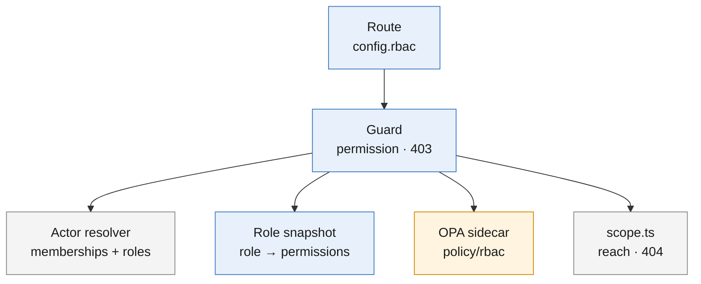

# RBAC Implementation Plan — aggregator-dpg

## Summary

The work to build [rbac-design-aggregator.md](rbac-design-aggregator.md) and [rbac-permissions-and-roles.md](rbac-permissions-and-roles.md) on branch `feat/805-rbac` (#849), based on `refactor/user-org-phase-5-wip`. Phase 5's inputs are in [phase-5-rbac-handoff.md](phase-5-rbac-handoff.md). Nobody loses access until an instance runs `RBAC_MODE=enforce`.

## Highlights

| Item         | Value                                                                                                                                                                          |
| ------------ | ------------------------------------------------------------------------------------------------------------------------------------------------------------------------------ |
| Base branch  | `refactor/user-org-phase-5-wip`; retarget the PR when Phase 5 merges                                                                                                           |
| Done         | R0–R2 (foundation, route declarations, Phase 5 adoption, enforcement); R3–R6 (role model, resolution, role assignment, custom roles); OPA sidecar deploy (bluedots-automation) |
| Next         | Switch instances on: deploy, run the backfill, `RBAC_MODE=log`, then `enforce`; R7 later                                                                                       |
| Reused as is | Permission catalogue, route declarations and boot check, OPA sidecar and authorizer, `scope.ts` reach, `RBAC_MODE`, contact masking, `iam_audit`, identity binding             |
| Replaced     | Organisation PermissionSets, per-user grants, their routes and console screens                                                                                                 |
| Decisions    | D1–D7 in the design's decision record                                                                                                                                          |

---

## 1. Order of work

```mermaid
flowchart LR
    R0["R0 · Foundation<br/>done"]
    R1["R1 · Routes<br/>done"]
    R15["R1.5 · Phase 5<br/>done"]
    R2["R2 · Enforce<br/>done"]
    R3["R3 · Data model<br/>+ catalogue"]
    R4["R4 · Resolve<br/>+ decide"]
    R5["R5 · Assign<br/>roles"]
    R6["R6 · Custom<br/>roles"]
    R7["R7 · Role in<br/>token · later"]
    R0 --> R1
    R1 --> R15
    R15 --> R2
    R2 --> R3
    R3 --> R4
    R4 --> R5
    R5 --> R6
    R6 --> R7
    classDef done fill:#eaf6ec,stroke:#3f9a52,color:#1a1a1a
    classDef todo fill:#e8f1fb,stroke:#3b78c4,color:#1a1a1a
    classDef later fill:#f4f4f4,stroke:#888,color:#1a1a1a
    class R0,R1,R15,R2,R3,R4,R5,R6 done
    class R7 later
```

Green: done. Grey: later.

| Step                        | Status      | Blocked by                                                                              |
| --------------------------- | ----------- | --------------------------------------------------------------------------------------- |
| R0 Foundation               | Done        | -                                                                                       |
| R1 Route declarations       | Done        | -                                                                                       |
| R1.5 Adopt Phase 5          | Done        | -                                                                                       |
| R2 Enforce                  | Done (code) | Switching on per instance: OPA sidecar deployed, deployment realm gate (Phase 5 owners) |
| R3 Data model and catalogue | Code done   | Landed with R4: the new `rbac.yaml` shape needs the new evaluation                      |
| R4 Resolve and decide       | Code done   | -                                                                                       |
| R5 Assign roles             | Code done   | -                                                                                       |
| R6 Custom roles             | Code done   | -                                                                                       |
| R7 Role in the token        | Later       | Not scheduled; needs the deployment realm's admin-only attributes (handoff H-11)        |

---

## 2. Components

Blue: RBAC. Grey: Phase 5, extended by RBAC. Orange: runtime sidecar.

| Component                                   | Path                                              | Change                                                                        |
| ------------------------------------------- | ------------------------------------------------- | ----------------------------------------------------------------------------- |
| Permission catalogue                        | `packages/rbac/src/interface.ts` (`CAPABILITIES`) | Unchanged; adds resource, action, description, sensitive                      |
| Built-in roles                              | `config/rbac.yaml`                                | New shape: roles only (§3 R3)                                                 |
| Role model, snapshot, effective permissions | `packages/rbac`                                   | Replaces the role ∩ set evaluation                                            |
| Policy and shared vectors                   | `policy/rbac/`                                    | Rewritten for "active and holds the permission; no PII through the root"      |
| Catalogue store                             | `apps/api/src/services/rbac-catalogue/`           | Syncs `permission` and built-in `role` rows; loads the snapshot; 30 s refresh |
| Role assignment store                       | `apps/api/src/services/role-store/`               | Replaces `grant-store`: `user_role` rows and `iam_audit`                      |
| Actor resolver                              | `apps/api/src/services/auth/actor/`               | Adds additional roles; drops `grants` and `permissionSet`                     |
| Guard                                       | `apps/api/src/services/authz/guard.ts`            | Permissions in the target organisation                                        |
| Roles API                                   | `apps/api/src/routes/v1-iam.ts`                   | Replaces the grant and PermissionSet routes                                   |
| Decision services                           | `services/decisions/coordinator.ts`, `org.ts`     | Revoke additional roles when membership or ownership ends                     |
| Console                                     | `apps/web`                                        | Roles panels replace the grants panel and PermissionSet picker                |

---

## 3. Steps

### R0–R2 (done)

Capability catalogue, OPA authorizer and sidecar, every route declared with a boot check and snapshot, Phase 5's resolver and `requireActor()`, `capabilities` in `GET /v1/user/read/me`, contact masking, identity binding, and portal hiding. These stay. R2's two deferrals stay open: retiring the emailed decision links (H-7, H-8) and the worker re-check before PII jobs.

### R3 — Data model and catalogue (code done)

| Task                                                                                                                                            | Where                                               | Done when                                                                                                                    |
| ----------------------------------------------------------------------------------------------------------------------------------------------- | --------------------------------------------------- | ---------------------------------------------------------------------------------------------------------------------------- |
| Rewrite migration `0030_rbac`: `permission`, `role`, `role_permission`, `user_role`, `iam_audit` (design §1); drop the `0031` draft             | `apps/api/drizzle/migrations`, `packages/db-schema` | Done: constraints and foreign keys tested on Postgres 16 (`rbac-catalogue`, `role-store` integration suites)                 |
| Dev databases that applied an earlier `0030` / `0031`                                                                                           | local only                                          | Reset by hand (drop the old RBAC tables and the `0030`/`0031` migration rows); the earlier `0030` never left `feat/805-rbac` |
| Permission catalogue with resource, action, description, sensitive                                                                              | `packages/rbac`                                     | Matches the catalogue §2                                                                                                     |
| `rbac.yaml` holds the six built-in roles: key, name, account type, `base_for`, assignable org types, `assigned_by`, `max_days`, permissions     | `config/rbac.yaml`, `packages/rbac`                 | Validated at boot; tests assert the role × permission matrix of the catalogue §3                                             |
| Sync at start: upsert permissions (others `deprecated`), upsert built-in roles and their permissions under an advisory lock; leave custom roles | catalogue store, `services/authz/runtime.ts`        | Concurrent boots sync once; a removed permission is marked, not deleted                                                      |
| Role snapshot with a checksum of `role` + `role_permission`; refresh every `RBAC_CATALOGUE_REFRESH_MS`; keep the last good snapshot             | `services/authz/runtime.ts`                         | Tests: unchanged, reloaded, invalid, store down, timer                                                                       |

### R4 — Resolve and decide (code done)

| Task                                                                                                                                       | Where                           | Done when                                                                        |
| ------------------------------------------------------------------------------------------------------------------------------------------ | ------------------------------- | -------------------------------------------------------------------------------- |
| Resolver returns memberships (Phase 5 `orgs` with `relation`) and live additional roles (`user_role`, not expired, not revoked)            | `services/auth/actor/store.ts`  | Tests: coordinator, owner of several orgs, root owner, expired and revoked roles |
| Base roles from membership: member → Coordinator, aggregator owner → Org Admin, root owner → Network Admin                                 | `packages/rbac`                 | Matches the design §1 table                                                      |
| Effective permissions in the target organisation: union over it and its ancestors; routes without a target use the user's own organisation | `services/authz/guard.ts`       | Test with an owner of two orgs holding different additional roles                |
| OPA input: permission, active, permissions, organisation type; policy and vectors rewritten; TypeScript mirror kept in step                | `policy/rbac/`, `packages/rbac` | `opa test` and the vectors test pass on the same file                            |
| `GET /v1/user/read/me` returns permissions per organisation; portal `can()` reads them                                                     | API, `apps/web`                 | Portal and console hide what the user cannot use in that organisation            |
| Remove `organisations.permission_set`, `user_permission_grant`, the grant store and PermissionSet code                                     | API, web, `packages/rbac`       | No references left; dep-check clean                                              |

Access is unchanged while `RBAC_MODE` is `off` or `log`. At `enforce` it changes for admins and coordinators: see the note under catalogue §3 and open item 5.

### R5 — Assign roles (code done)

| Task                                                                                                                                            | Where                                     | Done when                                                                                                                                        |
| ----------------------------------------------------------------------------------------------------------------------------------------------- | ----------------------------------------- | ------------------------------------------------------------------------------------------------------------------------------------------------ |
| Role assignment store: assign, revoke, list; each write with its `iam_audit` row in one transaction                                             | `services/role-store/`                    | Postgres integration test                                                                                                                        |
| Roles API (design §4) with the checks in order: reach, not a base role, membership, `assigned_by`, not self, account type, org type, `max_days` | `routes/v1-iam.ts`                        | One failing-then-passing test per check                                                                                                          |
| Membership or ownership ends: the user's additional roles in that organisation are revoked                                                      | decision services, `organisation-root.ts` | Done: right after the user-org change, best effort and logged; a leftover row grants nothing (a role counts only where the user belongs or owns) |
| Console: coordinator page roles panel (PII Access, Data Export); organisation page owner panel (Org Onboarder)                                  | `apps/web`                                | Component and BFF route tests                                                                                                                    |
| Backfill for existing instances: PII Access (90 days) and Data Export for active coordinators, audited                                          | `scripts/sql/rbac-backfill-roles.sql`     | Done: idempotent, refuses before the roles are synced and beyond PII Access's `max_days` (tested on Postgres 16)                                 |

### R6 — Custom roles (code done)

| Task                                                                                                                 | Where                               | Done when                                           |
| -------------------------------------------------------------------------------------------------------------------- | ----------------------------------- | --------------------------------------------------- |
| Create, edit, delete custom roles (network admin); built-in roles refused; delete refused while assigned; at most 50 | `routes/v1-iam.ts`, catalogue store | Tests per rule; the editing replica reloads at once |
| Roles page in the console                                                                                            | `apps/web`                          | Component tests                                     |

### R7 — Role in the token (later)

Not scheduled. Kept here so the design stays ready for it.

| Task                                                                                                                        | Where                                                     | Done when                                   |
| --------------------------------------------------------------------------------------------------------------------------- | --------------------------------------------------------- | ------------------------------------------- |
| Admin-only attribute with the user's role keys per organisation, written by the API on every role change; mapper to a claim | API idp-admin; realm in this repo and bluedots-automation | The user cannot edit it                     |
| Resolver uses the claim when present; the database stays the authority for expiry and revocation                            | `services/auth/actor`                                     | Tests: claim present, stale claim, no claim |

---

## 4. Tests

| Level                                 | Covers                                                                                                     |
| ------------------------------------- | ---------------------------------------------------------------------------------------------------------- |
| Rego (`opa test`) + TypeScript mirror | One `vectors.json`: holds / lacks the permission, inactive user, PII through the root                      |
| Unit (Vitest, ≥ 70 %)                 | `packages/rbac` (yaml, base roles, effective permissions), guard, resolver, stores (in-memory), roles API  |
| Integration (Postgres 16)             | Migration, sync race, snapshot checksum, assignment store, foreign keys                                    |
| Route snapshot                        | Every route's declaration; any change shows in review                                                      |
| E2E (`aggregator-e2e` skill)          | Owner approves a coordinator → export denied → Data Export assigned → allowed; PII Access expires → denied |

---

## 5. Work outside this repo

| Repo                  | Change                                                                       | Step                                                                       |
| --------------------- | ---------------------------------------------------------------------------- | -------------------------------------------------------------------------- |
| `bluedots-automation` | OPA sidecar in the API pod: done on `feat/aggregator-opa-sidecar`            | Before `log`                                                               |
| `bluedots-automation` | `rbac.config` override now carries built-in roles only; document it          | R3                                                                         |
| `bluedots-automation` | Portal gate for org owners and admin-only attributes in the deployment realm | Phase 5 owners; `hotfix/realm-admin-only-attributes` covers the attributes |
| `bluedots-automation` | Role claim attribute and mapper                                              | R7                                                                         |

---

## 6. Open items

| #   | Item                                                                                                                                                        | Recommendation                                                                                                                                |
| --- | ----------------------------------------------------------------------------------------------------------------------------------------------------------- | --------------------------------------------------------------------------------------------------------------------------------------------- |
| 1   | Existing coordinators export lists and decrypted profiles today                                                                                             | Run the R5 backfill (Data Export, PII Access) before an instance switches to `enforce`                                                        |
| 2   | `refactor/user-org-phase-5-wip` has moved on since the base                                                                                                 | Rebase before R3; force-push with lease                                                                                                       |
| 3   | `features/rbac/` Gherkin specs describe PermissionSets and `rbac.yaml` grants                                                                               | Their owner updates them to the role model                                                                                                    |
| 4   | Admin views across many coordinators call Signals once per tenant                                                                                           | Measure after R4; cache per tenant if slow                                                                                                    |
| 5   | At `enforce`, no admin can export decrypted profiles or download `errors.csv` (no admin role holds `profiles.view_pii`), and Org Admin loses `orgs.onboard` | By design (catalogue §3). Tell each instance's admins before switching to `enforce`; assign Org Onboarder to owners who approve organisations |

---

## Appendix A. Route declarations

| Routes                                                                                                                       | Declaration                                                                                                   |
| ---------------------------------------------------------------------------------------------------------------------------- | ------------------------------------------------------------------------------------------------------------- |
| `health.ts`, `aggregator-config.ts`, `public-registration-links.ts`, `public-lookup.ts`                                      | `public`                                                                                                      |
| `aggregator-registrations.ts` (create), `aggregator-orgs.ts` (create, list), `aggregator-maintenance.ts`, `campaign-dump.ts` | `service`                                                                                                     |
| `aggregator-approvals.ts`, `aggregator-org-approvals.ts`, `invites.ts`                                                       | `link_token` until the emailed links are retired                                                              |
| `aggregator-profile.ts`                                                                                                      | `self`                                                                                                        |
| `support.ts`, `GET /v1/user/read/me`                                                                                         | `signed_in`                                                                                                   |
| `registration-links.ts`                                                                                                      | reads `profiles.view`; writes `profiles.onboard`                                                              |
| `bulk-uploads.ts`                                                                                                            | list and status `profiles.view`; template, create, start `profiles.onboard`; `errors.csv` `profiles.view_pii` |
| `onboarding.ts`, `campaign-jobs.ts`                                                                                          | `profiles.view`                                                                                               |
| `dashboard.ts`                                                                                                               | read `profiles.view`; export `profiles.export`; export profiles `profiles.view_pii`                           |
| `campaign-export.ts`                                                                                                         | `profiles.view_pii`                                                                                           |
| `campaign-email.ts`, `campaign-voice.ts`                                                                                     | `campaigns.run`                                                                                               |
| `/v1/user/read/:id`, `/v1/user/search`, `/v1/user/create`, `/v1/user/decision/:id`, `/v1/user/metadata/update/:id`           | `org.manage`                                                                                                  |
| `/v1/org/read/:id`, `/v1/org/search`, `/v1/org/metadata/update/:id`                                                          | `org.manage` (D1; rename also needs `network.administer`)                                                     |
| `/v1/org/decision/:id`                                                                                                       | `orgs.onboard`                                                                                                |
| `/v1/org/access/repair/:id`                                                                                                  | `network.administer` (D2)                                                                                     |
| `GET /v1/roles`, `GET /v1/user/roles/:id`                                                                                    | `org.manage`                                                                                                  |
| `POST /v1/user/role/assign/:id`, `POST /v1/user/role/revoke/:id`                                                             | `signed_in` at the route; the role's `assigned_by` checked in the handler                                     |
| `POST /v1/roles/create`, `PATCH /v1/roles/update/:key`, `POST /v1/roles/delete/:key`                                         | `network.administer`                                                                                          |
