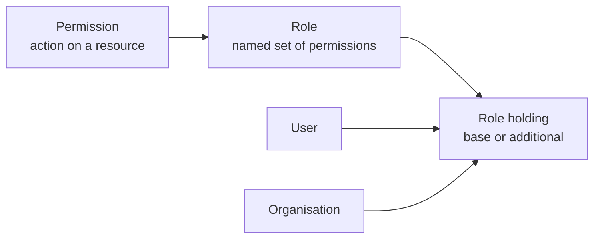

# RBAC Permissions and Roles — aggregator-dpg

## Summary

The permissions the aggregator checks, the built-in roles that group them, and the rules for assigning roles. A user holds one or more roles in an organisation; what they may do there is the union of those roles' permissions. The design that stores and enforces this is [rbac-design-aggregator.md](rbac-design-aggregator.md).

## Highlights

| Item             | Value                                                                                                                                      |
| ---------------- | ------------------------------------------------------------------------------------------------------------------------------------------ |
| Model            | Permission → role → user in an organisation (NIST core RBAC per organisation); base roles follow membership, additional roles are assigned |
| Permissions      | 15, fixed in code; each is an action on a resource                                                                                         |
| Built-in roles   | 6: Network Admin, Org Admin, Org Onboarder, Coordinator, PII Access, Data Export                                                           |
| Effective access | Union of the permissions of the user's base and live additional roles in the organisation (or an ancestor of it)                           |
| Custom roles     | Composed from existing permissions; added to users alongside built-in roles                                                                |

---

## 1. Model

| Term                  | Meaning                                                                                                                    |
| --------------------- | -------------------------------------------------------------------------------------------------------------------------- |
| Permission            | One thing the API checks, e.g. `profiles.export` = export on profiles                                                      |
| Role                  | A named set of permissions; built-in or custom                                                                             |
| Base role             | The role membership implies: member → Coordinator, owner → Org Admin, root owner → Network Admin                           |
| Additional role       | A role assigned to a user in one organisation, optionally until an expiry                                                  |
| Effective permissions | Union of the permissions of the user's base and live additional roles in the organisation acted on or any of its ancestors |

---

## 2. Permissions

| Key                      | Resource      | Action        | Meaning                                                                   | Sensitive            |
| ------------------------ | ------------- | ------------- | ------------------------------------------------------------------------- | -------------------- |
| `profiles.view`          | profiles      | view          | See masked profiles, dashboards, metrics                                  | -                    |
| `profiles.export`        | profiles      | export        | Download masked lists                                                     | -                    |
| `profiles.view_pii`      | profiles      | view_pii      | See and export decrypted details                                          | Audited              |
| `profiles.onboard`       | profiles      | onboard       | Links, bulk uploads, forms; edit and pause profiles                       | -                    |
| `profiles.verify`        | profiles      | verify        | Mark profiles verified                                                    | -                    |
| `profiles.retire`        | profiles      | retire        | Retire a profile (irreversible)                                           | -                    |
| `profiles.move`          | profiles      | move          | Move profiles to another aggregator                                       | -                    |
| `profiles.act_on_behalf` | profiles      | act_on_behalf | Connect or apply for a profile's owner                                    | Service clients only |
| `campaigns.run`          | campaigns     | run           | Email and voice campaigns                                                 | Audited              |
| `orgs.onboard`           | organisations | onboard       | Invite and approve child organisations                                    | -                    |
| `orgs.block`             | organisations | block         | Suspend or remove a child organisation                                    | -                    |
| `org.manage`             | organisation  | manage        | Organisation profile; invite and approve coordinators; assign their roles | -                    |
| `contact.unmask`         | contacts      | unmask        | See the full email and phone of users in reach                            | Audited              |
| `agreement.manage`       | agreements    | manage        | Create and link agreements (terms, privacy, consent)                      | -                    |
| `network.administer`     | network       | administer    | Network configuration, service clients, audit, bans; assign admin roles   | -                    |

---

## 3. Built-in roles

| Role          | Kind                                         | Account type | Assignable in            | Who holds it                                                         | Expiry          |
| ------------- | -------------------------------------------- | ------------ | ------------------------ | -------------------------------------------------------------------- | --------------- |
| Network Admin | Base: root owner                             | admin        | root organisation        | The root's owner (`organisations.org_owner` of the root)             | -               |
| Org Admin     | Base: organisation owner                     | admin        | aggregator organisations | Each organisation's owner (`organisations.org_owner`)                | -               |
| Coordinator   | Base: organisation member                    | coordinator  | aggregator organisations | Each approved coordinator, in `users.org_id`                         | -               |
| Org Onboarder | Additional, assigned by `network.administer` | admin        | aggregator organisations | The owner of an organisation that onboards others (Super Aggregator) | -               |
| PII Access    | Additional, assigned by `org.manage`         | coordinator  | aggregator organisations | A coordinator who needs decrypted details                            | 90 days at most |
| Data Export   | Additional, assigned by `org.manage`         | coordinator  | aggregator organisations | A coordinator who downloads lists                                    | -               |

| Permission               | Network Admin | Org Admin | Org Onboarder | Coordinator | PII Access | Data Export |
| ------------------------ | ------------- | --------- | ------------- | ----------- | ---------- | ----------- |
| `profiles.view`          | ✓             | ✓         | -             | ✓           | -          | -           |
| `profiles.export`        | ✓             | ✓         | -             | -           | -          | ✓           |
| `profiles.view_pii`      | -             | -         | -             | -           | ✓          | -           |
| `profiles.onboard`       | ✓             | ✓         | -             | ✓           | -          | -           |
| `profiles.verify`        | ✓             | -         | ✓             | -           | -          | -           |
| `profiles.retire`        | ✓             | ✓         | -             | -           | -          | -           |
| `profiles.move`          | ✓             | -         | ✓             | -           | -          | -           |
| `profiles.act_on_behalf` | -             | -         | -             | -           | -          | -           |
| `campaigns.run`          | ✓             | ✓         | -             | ✓           | -          | -           |
| `orgs.onboard`           | ✓             | -         | ✓             | -           | -          | -           |
| `orgs.block`             | ✓             | -         | -             | -           | -          | -           |
| `org.manage`             | ✓             | ✓         | -             | -           | -          | -           |
| `contact.unmask`         | ✓             | ✓         | -             | -           | -          | -           |
| `agreement.manage`       | ✓             | -         | -             | -           | -          | -           |
| `network.administer`     | ✓             | -         | -             | -           | -          | -           |

Base roles come from the user-org model and are never assigned by hand. Additional roles are assigned in an organisation the user belongs to or owns, and combine with the base role: an owner of a Super Aggregator holds Org Admin and Org Onboarder; a coordinator who exports lists holds Coordinator and Data Export. `profiles.act_on_behalf` is in no built-in role: only service clients use it.

---

## 4. Rules

| Rule                         | Detail                                                                                                                                                                |
| ---------------------------- | --------------------------------------------------------------------------------------------------------------------------------------------------------------------- |
| Union, no caps               | Effective permissions are the union of the user's live roles in the organisation or its ancestors; nothing intersects them                                            |
| Membership first             | An additional role is assigned only in an organisation the user belongs to (`users.org_id`) or owns (`organisations.org_owner`); leaving that organisation revokes it |
| Who assigns                  | An additional role is assigned by a user holding its "assigned by" permission in that organisation (or an ancestor); base roles follow membership and ownership       |
| Nobody assigns to themselves | Holds for every role                                                                                                                                                  |
| Account type                 | A role is assigned only to users of its account type: admin roles to org owners, coordinator roles to coordinators                                                    |
| Assignable organisations     | A role is assigned only in the organisation types it lists; PII Access is never assigned in the root, so personal data is never reachable through it                  |
| Separation of duties         | Org Admin and PII Access are never held by the same user in the same organisation                                                                                     |
| Expiry                       | A role with a maximum validity (PII Access, 90 days) is assigned with an expiry no later than that; it stops counting when it expires                                 |
| Built-in roles are fixed     | Their permissions come from code and are re-applied at every start; change access by adding roles, not by editing built-ins                                           |

---

## 5. Custom roles

| Item          | Rule                                                                                                              |
| ------------- | ----------------------------------------------------------------------------------------------------------------- |
| Composed from | Existing permissions only; the 15 above                                                                           |
| Created by    | The network admin                                                                                                 |
| Fields        | Name, description, account type, assignable organisation types, assigned-by permission, optional maximum validity |
| Used by       | Assigning it to users alongside their built-in roles; it only ever adds permissions                               |
| Removed       | Refused while any live assignment uses it                                                                         |
